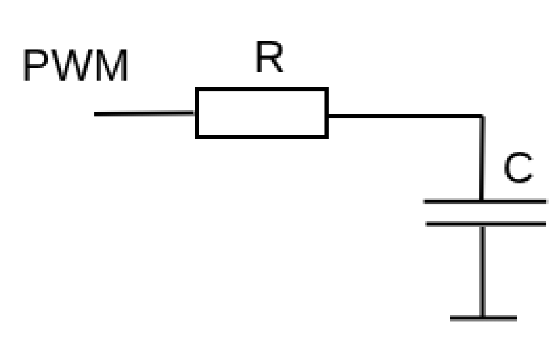
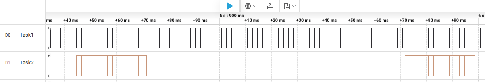

# Описание
Данная работа реализует регулятор напряжения для цепи с резистором и конденсатором с использованием FreeRTOS с микроконтроллером stm32f407vgt6.

С кондесатора снимается напряжение. R = 1 КОм, C = 10 мкФ. По обратной связи с данного кондесатора и желаемого значения формируем ШИМ сигнал.

Желаемое значение получаем от потенциометра через ADC1 по каналу 0. А реальное значение также получаем через ADC1 через канал 1. Настраивается dma для этих двух каналов и записывает значение в буффер из 2 элементов.

Для отображения данных используется oled дисплей ssd1306. Для него используется библиотека, она синхронная.

Сам АЦП запускается по таймеру TIM3 с частотой 500 Гц. Соотвественно с такой частотой работает сам пи регулятор.

Частота ШИМ сигнала 5 КГц. Коэффициенты регулятора подобраны так для непрерывной системы, что собственная частота системы 32 Гц. Так как большая разница между частотой регулятора и собственной частотой системы, то можно приблеженно считать коэффициенты приемлимыми.

# Картина с логического анализатора
Первая задача это задача регулятора, вторая задача oled дисплея.

# Видео
В репозитории будет видео работы самой системы.